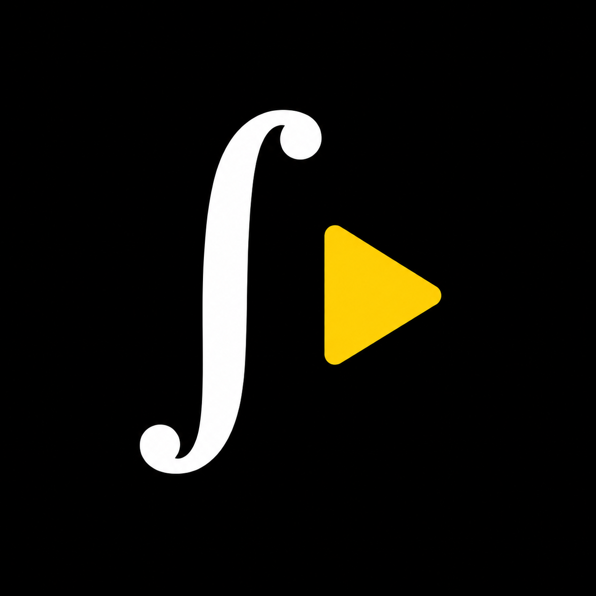
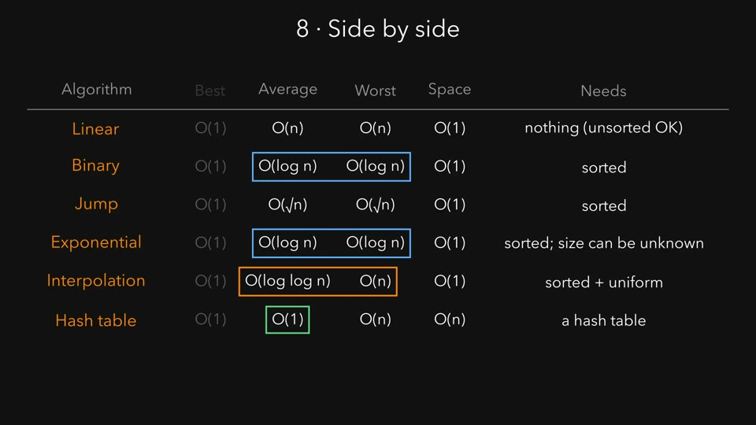
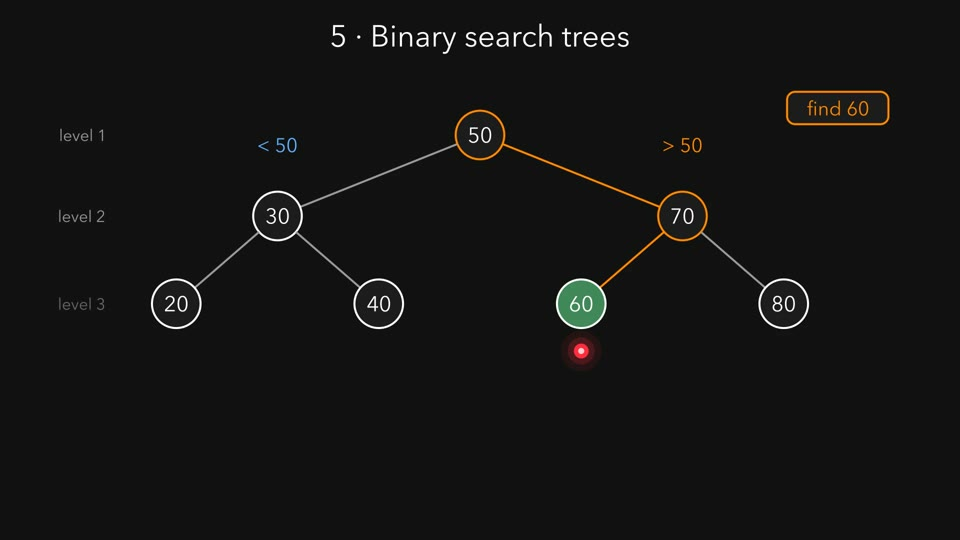

# explainer-video

<p align="center">
  
</p>

A [Claude Code](https://claude.com/claude-code) skill for narrated explainer videos.
Ask Claude for "an animated explainer of this paper". It researches the source, writes a narration
script, plans what the viewer should see, picks the fastest framework that shows it well on your
machine, animates it, and voices it locally with [Kokoro](https://huggingface.co/hexgrad/Kokoro-82M).
Every animation is timed to the words that describe it. The result is an MP4 with subtitles plus a
cheat sheet of the formulas and sources.

- **Framework per video.** [Remotion](https://www.remotion.dev) (React, rendered in headless Chrome)
  for diagrams, charts, text, code and static formulas: fast on any CPU, no GPU needed.
  [ManimGX](https://pypi.org/project/manimgx/) when the video needs math animation (equations
  transforming, shapes morphing, geometry) or 3D: best with a GPU.
- **Hardware aware.** `scripts/pick.py` checks the machine first. When the hardware rules out the
  framework that would do the job best, or makes it or the voice slow, the skill tells you, gives you
  the options, and asks for feedback at hi@manoletre.com.
- **Offline voice.** Kokoro (82M parameters) speaks each line, about 4 times faster than real time on
  8 CPU cores; [faster-whisper](https://github.com/SYSTRAN/faster-whisper) transcribes it back, flags
  lines that came out wrong, and times every word for the animations and subtitles.
- **House style.** PT Serif, high contrast, the gold-on-black of [manoletre.com](https://manoletre.com),
  in a dark (default) or light theme, chosen for all videos or for one.

## Examples

| [](https://github.com/manoletre/explainer-video/releases/download/v0.1.0/SearchAlgorithms.mp4) | [](https://github.com/manoletre/explainer-video/releases/download/v0.1.0/DataStructures.mp4) |
|---|---|
| **[Search algorithms, compared](https://github.com/manoletre/explainer-video/releases/download/v0.1.0/SearchAlgorithms.mp4)** (7:58)<br>Linear, binary, jump, exponential, interpolation and hash table lookup: how each one works, what it costs, and when to pick it. Source and cheat sheet in [`examples/search-algorithms/`](examples/search-algorithms/). | **[Must-know data structures](https://github.com/manoletre/explainer-video/releases/download/v0.1.0/DataStructures.mp4)** (10:00)<br>Arrays, linked lists, stacks and queues, hash tables, binary search trees, heaps, graphs and tries: how each is laid out, what it costs, and how to choose. Source and cheat sheet in [`examples/data-structures/`](examples/data-structures/). |

Both were made from a one-line request, for interview prep, with ManimGX and the earlier voice and
colors; their scenes now use Kokoro and the house style. [`examples/hash-tables/`](examples/hash-tables/)
is a short Remotion video in the current style (1:18, rendered at 1080p30 in under a minute on an
8 vCPU cloud VM with no GPU), and [`examples/sec/`](examples/sec/) an 11 minute ManimGX video with
real math (*Self-Evolving Curriculum for LLM Reasoning*, Chen et al., 2025). One short example per
other framework, each rendered at 1080p30 on the same VM: [`examples/water-3d/`](examples/water-3d/)
(three.js in Remotion), [`examples/linked-list-mc/`](examples/linked-list-mc/) (Motion Canvas),
[`examples/gradient-descent-ce/`](examples/gradient-descent-ce/) (Manim Community) and
[`examples/water-blender/`](examples/water-blender/) (Blender).

## How it decides

1. **Visualization first.** Claude plans what is on screen in each section and names the needs:
   `text`, `diagram`, `chart`, `plot`, `formula`, `code`, `ui`, `image`, `timeline`,
   `vector-tween`, `math-animation`, `3d-math`, `3d`, `photoreal`.
2. **Hardware second.** `python3 scripts/pick.py diagram chart formula` runs `scripts/hardware.py`
   (CPU, RAM, disk, GPU, Node, ManimGX, a few seconds of voice speed test).
3. **Framework third.** Of the frameworks that do every need well, it picks the one that runs best
   here, and prints `FIX` lines (things to install) and `NOTICE` lines (hardware limits, which
   Claude passes on to you with the feedback address).

| framework | good for | weak at | hardware | speed |
|---|---|---|---|---|
| **Remotion** | diagrams, charts, text, code, UI, images, static formulas (KaTeX): everything 2D | morphing equations and shapes, real 3D | CPU only; 2 GB RAM (about 1 GB per Chrome worker); Node 18+ | 8 min of 1080p30 in about 5 min on 8 CPU cores |
| **Motion Canvas** | Manim-style vector tweening: shapes and arrows moving and re-linking, code animations | charts, images, dense layout (no HTML/CSS) | CPU only; Node 18+ | 18 s of 1080p30 in 14 s on 8 CPU cores |
| **three.js** (in Remotion, `@remotion/three`) | 3D that isn't math: molecules, models, objects, camera moves, mixed with any 2D block | photoreal lighting; heavy scenes on the CPU | a GPU for heavy scenes; simple ones render on the CPU (SwiftShader) | CPU (8 cores): a simple 20 s 3D shot at 1080p30 in 39 s |
| **ManimGX** | math: equations transforming, graphs, geometry, linear algebra, 3D surfaces | UI, images, dense text; slow without a GPU | a Metal or Vulkan GPU; without one Mesa's lavapipe on the CPU | GPU: 1080p60 in minutes. CPU (8 cores): 41 min at 1080p30, 9 min at 540p |
| **Manim Community** | the same 2D math as ManimGX, on the CPU, with the most examples online | 3D (slow in Cairo), UI, images | CPU only (Cairo); LaTeX and dvisvgm for formulas | 27 s of 1080p30 with a formula transform in 12 s |
| **Blender** | photoreal 3D: lighting, materials, shadows, physics, cinematic shots | slow without a GPU; overkill for diagrams and text | a GPU (Eevee); on the CPU Cycles, about 1.7 s per 960x540 frame on 8 cores | GPU: minutes. CPU: about 15 min per 30 s of 960x540 |

Timings are measured on an 8 vCPU cloud VM with no GPU: the same 8 minute explainer took 4.6 minutes
in Remotion at 1920x1080, 30 fps, and 41 minutes in ManimGX (which there draws on the CPU). On a
MacBook's GPU, ManimGX renders it in about 10 minutes.

## Install

You need macOS or Linux (x64 or arm64), [Claude Code](https://claude.com/claude-code), Python 3.9 or
newer, [uv](https://docs.astral.sh/uv/), ffmpeg, and for Remotion videos Node.js 18 or newer. Setup
takes about 5 minutes.

### Hardware

| | Minimum | Comfortable |
|---|---|---|
| CPU | 2 cores (x64 or arm64) | 8 cores or Apple silicon |
| RAM | 2 GB (Remotion with one Chrome worker, the int8 voice) | 8 GB or more |
| Disk | 3 GB free | 10 GB free |
| GPU | none, for Remotion videos | a Metal or Vulkan GPU, for ManimGX at 1080p60 |

The voice runs on the CPU everywhere: about 0.25 s of work per second of speech on 8 cores and about
real time on one, in 650 MB of RAM (400 MB with `KOKORO_MODEL=int8`), plus about half that again for
the Whisper check. Remotion renders on the CPU too, so it needs no GPU; more cores render
proportionally faster.

ManimGX draws every frame through wgpu (Metal on macOS, Vulkan on Linux). On a Linux box with no GPU
driver (most cloud VMs and containers) it fails with `no GPU adapter` until you install Mesa's Vulkan
drivers (`sudo apt install mesa-vulkan-drivers`); it then draws on the CPU, about 1.2 s per changed
1080p frame per process. On the CPU, lavapipe's and ManimGX's worker threads race and garble frames at
random, so `scripts/render.py` pins every process to one thread and renders the video as one segment
per core in parallel; it times your scene's real frames and picks the format that finishes within a
10 minute budget (on an 8 vCPU VM, about 960x540), listing what better formats would cost. For full
quality without a local GPU, render on a machine that has one (a small rented cloud GPU is plenty, as
long as `vulkaninfo --summary` lists it), or pick Remotion when the video doesn't need math animation.

### 1. Install ffmpeg, uv and Node

On macOS, with [Homebrew](https://brew.sh):

```bash
brew install ffmpeg uv node
```

On Debian or Ubuntu (Node from [nodejs.org](https://nodejs.org) or nvm if your distribution's is
older than 18):

```bash
sudo apt install ffmpeg python3 curl nodejs npm
curl -LsSf https://astral.sh/uv/install.sh | sh
```

### 2. Clone the skill into Claude Code's skills folder

```bash
git clone https://github.com/manoletre/explainer-video ~/.claude/skills/explainer-video
```

### 3. Set up the voice

```bash
~/.claude/skills/explainer-video/scripts/setup_voice.sh
```

This makes a Python environment with Kokoro and faster-whisper in `~/.cache/explainer-video/`, downloads
Kokoro's model (325 MB; `KOKORO_MODEL=int8` fetches the 92 MB one) and Whisper's (150 MB), and speaks
and transcribes a test sentence: `voice ok: spoke 1.7 s of audio in 1.7 s; heard: Hello from Explainer Video.`

### 4. Check the machine

```bash
python3 ~/.claude/skills/explainer-video/scripts/hardware.py
```

It prints the CPU, RAM, disk, GPU and tools, then each framework's and the voice's status here (`fast`,
`slow`, `setup`, `unavailable`) with a `FIX` line for anything to install. `pick.py --list` prints the
framework table.

### 5. Optional: ManimGX, for math and 3D videos

```bash
uv tool install manimgx
~/.claude/skills/explainer-video/scripts/setup_fonts.sh
```

`setup_fonts.sh` installs PT Serif and JetBrains Mono for the system, which ManimGX draws text with
(Remotion bundles its fonts). Scenes that typeset formulas with `m.MathTex` also need LaTeX: MacTeX on
macOS (`brew install --cask mactex-no-gui`) or TeX Live on Linux. On Linux without a GPU, also
`sudo apt install mesa-vulkan-drivers`.

### 6. Optional: Manim Community, Blender

```bash
~/.claude/skills/explainer-video/scripts/setup_manim_ce.sh   # needs Cairo, Pango, pkg-config; LaTeX + dvisvgm
~/.claude/skills/explainer-video/scripts/setup_blender.sh    # Linux x86_64; macOS: brew install --cask blender
```

Motion Canvas and three.js need only Node; their packages install per video.

### 7. Start Claude Code

Open a new Claude Code session (skills load at startup) and ask for a video, or type `/explainer-video`.

### Settings

All optional, set as environment variables:

| Variable | Default | What it changes |
|---|---|---|
| `EXPLAINER_THEME` | the saved default, else `dark` | `light` or `dark` for every video (`THEME` in a video's `narration.py` wins) |
| `EXPLAINER_HOME` | `~/.cache/explainer-video` | Where the voice environment and models live |
| `KOKORO_MODEL` | `fp32` | `int8`: the 92 MB model, for machines with little RAM or disk |
| `EXPLAINER_ASR_MODEL` | `base.en` (English), `base` | The Whisper model that checks and times the narration |

## Style

PT Serif for text, JetBrains Mono for code, high contrast, gold `#FFD700` as the one accent, from
manoletre.com. Two themes, defined in `scripts/style.py`:

- **dark** (default): black background, white text, gold highlights.
- **light**: white background, black text, gold highlight fills with black text, dark gold for accent
  text and lines.

For every video: `python3 scripts/style.py light` (saved in `~/.config/explainer-video/config.json`;
`style.py dark` switches back). For one video: `THEME = "light"` in its `narration.py`. Or just tell
Claude which you prefer.

## Use

In Claude Code:

> Make an explainer video of arXiv 2505.14970 and how it applies to this project.

The skill (`SKILL.md`) walks Claude through research, outline, the visualization plan and framework
choice, narration, voice, building and checking the scene, and render. Expect about 20–30 minutes end
to end for an 8 minute Remotion video.

To rebuild the Remotion example yourself:

```bash
cd ~/.claude/skills/explainer-video
python3 scripts/make_narration.py examples/hash-tables/narration.py
python3 scripts/remotion.py new examples/hash-tables      # installs the project
python3 scripts/remotion.py check examples/hash-tables    # storyboard, layout and sync reports
python3 scripts/remotion.py render examples/hash-tables   # examples/hash-tables/hash-tables.mp4 and .srt
```

and a ManimGX example:

```bash
python3 scripts/make_narration.py examples/search-algorithms/narration.py
python3 scripts/render.py examples/search-algorithms/search_algorithms.py
```

## What's inside

- `SKILL.md`: the instructions Claude follows.
- `scripts/pick.py`: the needs, the framework table, and the choice for this machine, with notices.
- `scripts/hardware.py`: what this machine has, and each framework's and the voice's status on it.
- `scripts/voice.py`: Kokoro TTS, Whisper ASR with word times, word error rate.
- `scripts/setup_voice.sh`: sets up the voice environment and models.
- `scripts/make_narration.py`: speaks and checks every line; writes `audio/<key>.wav`, `report.json`, `words.json`.
- `scripts/style.py`: the themes (PT Serif, manoletre.com colors, dark and light) and the saved default.
- `scripts/remotion.py`: Remotion projects: `new`, `timeline` (narration times and track), `check`, `render`.
- `templates/remotion/`: the Remotion project it copies: `src/kit.tsx` (sections, boxes, text, formulas,
  arrows, charts, plots, code, pictures, the laser pointer, captions, the layout check) and `tools/`
  (storyboard and budgeted render).
- `templates/remotion/src/three.tsx`: 3D blocks for Remotion (`Scene3D` with camera moves, theme materials).
- `scripts/motion_canvas.py`, `templates/motion-canvas/`: Motion Canvas projects (`new`, `check`, `render`), the kit and the headless renderer.
- `scripts/manim_ce.py`, `scripts/manim_ce_kit.py`, `scripts/setup_manim_ce.sh`: Manim Community scenes timed to the narration, checks, budgeted render.
- `scripts/blender.py`, `scripts/blender_kit.py`, `scripts/setup_blender.sh`: Blender scenes timed to the narration, checks, budgeted render.
- `scripts/timeline.py`: narration times, track, sync and layout reports and storyboard sheets, shared by every framework.
- `scripts/render.py`: ManimGX renders at the best format that finishes within a time budget, with progress.
- `scripts/kokoro_voice.py`: the narration as a ManimGX scene's `voice` (`lfm_voice.py` keeps old scenes working).
- `scripts/stage.py`: ManimGX's laser pointer and the check for speech over an empty or frozen screen.
- `scripts/setup_fonts.sh`: PT Serif and JetBrains Mono for ManimGX.
- `examples/hash-tables/`: a short Remotion explainer: narration and `remotion/src/Video.tsx`.
- `examples/search-algorithms/`, `examples/data-structures/`, `examples/sec/`: ManimGX explainers.

## Feedback

If the skill couldn't use the right framework or the voice on your hardware, or anything else got in
the way, write to hi@manoletre.com.

## License

MIT
