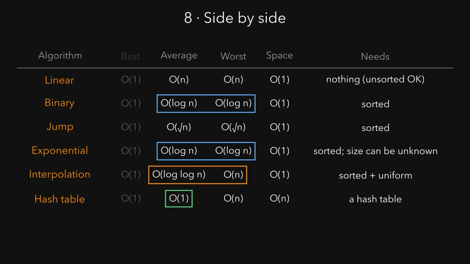
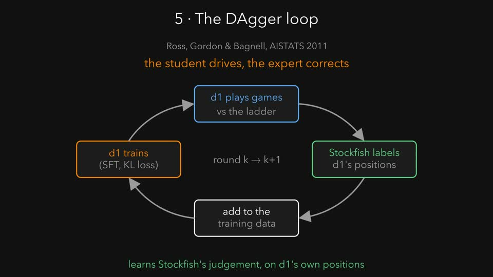
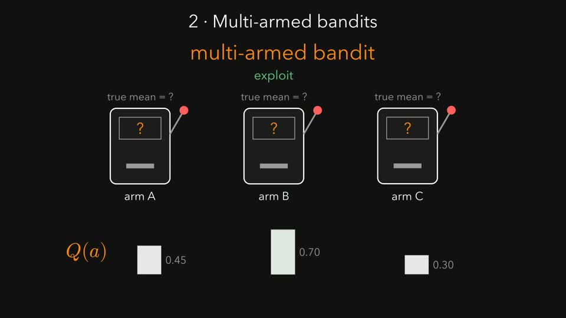

# explainer-video

<p align="center">
  
</p>

A [Claude Code](https://claude.com/claude-code) skill for narrated explainer videos.
Ask Claude for "an animated explainer of this paper". It researches the source, writes
a narration script, animates it with [ManimGX](https://pypi.org/project/manimgx/), and voices it
locally with [LFM3-Audio](https://huggingface.co/LiquidAI/LFM3-Audio-2B-GGUF) on llama.cpp. Every
animation is timed to the words that describe it. The result is an MP4 with subtitles plus a
cheat sheet of the formulas and sources.

Narration runs fully offline. The skill speaks each line up to three times, transcribes every
take back with the same model, and keeps the take closest to the script. Lines that still
come out wrong get flagged for a rewrite.

## Example

[](https://github.com/manoletre/explainer-video/releases/download/v0.1.0/SearchAlgorithms.mp4)

**[Search algorithms, compared](https://github.com/manoletre/explainer-video/releases/download/v0.1.0/SearchAlgorithms.mp4)** (7:58).
Linear, binary, jump, exponential, interpolation and hash table lookup: how each one works,
its best, average and worst case, its space, and when to pick it. It was made from a one-line
request ("create a video about all of these search algorithms that compares them") for interview prep.
Source and cheat sheet in [`examples/search-algorithms/`](examples/search-algorithms/).

### More examples

Both end with a section on how the idea applies to my chess-playing LLM project,
[Teaching chess to small language models](https://manoletre.com/chess), which fine-tunes small
Liquid models to solve chess puzzles and play games.

| [](https://github.com/manoletre/explainer-video/releases/download/v0.1.0/DAggerExplainer.mp4) | [](https://github.com/manoletre/explainer-video/releases/download/v0.1.0/SECExplainer.mp4) |
|---|---|
| **[DAgger: imitation learning that doesn't drift](https://github.com/manoletre/explainer-video/releases/download/v0.1.0/DAggerExplainer.mp4)** (7:33)<br>Ross, Gordon & Bagnell, AISTATS 2011 | **[Self-Evolving Curriculum for LLM reasoning](https://github.com/manoletre/explainer-video/releases/download/v0.1.0/SECExplainer.mp4)** (11:02)<br>Chen et al., 2025. Source in [`examples/sec/`](examples/sec/) |

## Install

You need macOS (Apple silicon or Intel) or Linux (x64 or arm64), [Claude Code](https://claude.com/claude-code),
Python 3.9 or newer, and about 3 GB of free disk space. Setup takes about 10 minutes, most of it
downloading the voice model.

### 1. Install ffmpeg and uv

[uv](https://docs.astral.sh/uv/) installs ManimGX; ffmpeg muxes the audio and video.

On macOS, with [Homebrew](https://brew.sh):

```bash
brew install ffmpeg uv
```

On Debian or Ubuntu:

```bash
sudo apt install ffmpeg python3 curl
```

```bash
curl -LsSf https://astral.sh/uv/install.sh | sh
```

### 2. Clone the skill into Claude Code's skills folder

Claude Code finds skills in `~/.claude/skills/`, so clone it there:

```bash
git clone https://github.com/manoletre/explainer-video ~/.claude/skills/explainer-video
```

### 3. Install ManimGX

```bash
uv tool install manimgx
```

Check that it's on your `PATH`:

```bash
manimgx --version
```

If the shell says `command not found`, run `uv tool update-shell`, open a new terminal, and check again.

### 4. Download the voice model and llama.cpp

```bash
~/.claude/skills/explainer-video/scripts/fetch_model.sh
```

This downloads LFM3-Audio-2B (Q8_0 GGUF plus its audio projector, about 2.2 GB) and a prebuilt
llama.cpp release (`b11985`) for your platform into `~/.lmstudio/models/LiquidAI/LFM3-Audio-2B-GGUF/`.
That's also where LM Studio keeps the model, so an existing LM Studio download is reused. Running the
script again skips whatever is already there.

### 5. Check the voice

```bash
cd ~/.claude/skills/explainer-video && python3 -c "import sys; sys.path.insert(0, 'scripts'); import lfm_audio as L; L.tts('Hello from explainer video.', '/tmp/hello.wav'); print(L.asr('/tmp/hello.wav'))"
```

It speaks the sentence into `/tmp/hello.wav`, transcribes it back, and prints
`Hello from Explainer Video.` (about 7 s on an M-series Mac). Play the file to hear the voice.

### 6. Start Claude Code

Open a new Claude Code session (skills load at startup) and ask for a video, or type `/explainer-video`.

### Optional: LaTeX

Scenes that typeset formulas with `m.MathTex` need a LaTeX install: MacTeX on macOS
(`brew install --cask mactex-no-gui`) or TeX Live on Linux. Scenes that use only `m.Text`, like
the search algorithms example, don't.

### Settings

All optional, set as environment variables before running Claude Code or the scripts:

| Variable | Default | What it changes |
|---|---|---|
| `LFM_AUDIO_CKPT` | `~/.lmstudio/models/LiquidAI/LFM3-Audio-2B-GGUF` | Where the model and llama.cpp live |
| `LFM_LLAMA_BUILD` | `b11985` | llama.cpp release to download and run (LFM3-Audio needs `b11960` or newer) |
| `LFM_AUDIO_RUNNER` | `$LFM_AUDIO_CKPT/runner/$LFM_LLAMA_BUILD` | A folder with your own `llama-tts` and `llama-mtmd-cli` |
| `LFM_AUDIO_QUANT` | `Q8_0` | Model quantization to download and use |

On an M-series Mac a line of narration takes about 3.5 s to speak and 3.5 s to check.

## Use

In Claude Code:

> Make an explainer video of arXiv 2505.14970 and how it applies to this project.

The skill (`SKILL.md`) walks Claude through research, outline, narration, voice generation,
layout inspection and render. An 8 minute video takes about half an hour end to end.

To rebuild an example yourself, voice it and then render it:

```bash
cd ~/.claude/skills/explainer-video && python3 scripts/make_narration.py examples/search-algorithms/narration.py
```

```bash
cd ~/.claude/skills/explainer-video && manimgx render examples/search-algorithms/search_algorithms.py
```

The MP4 and its `.srt` subtitles are written next to the scene file.

## What's inside

- `SKILL.md`: the instructions Claude follows.
- `scripts/lfm_audio.py`: TTS, ASR and word error rate on top of llama.cpp's `llama-tts` and `llama-mtmd-cli`.
- `scripts/make_narration.py`: generates and checks every narration clip; writes `audio/report.json`.
- `scripts/lfm_voice.py`: plugs those clips into a ManimGX scene as its `voice`.
- `scripts/fetch_model.sh`: downloads the model and a llama.cpp release that runs it.
- `examples/search-algorithms/`: the 8 minute search algorithms video: scene, narration and cheat sheet.
- `examples/sec/`: an 11 minute video explaining *Self-Evolving Curriculum for LLM Reasoning*
  (Chen et al., 2025).

## License

MIT
